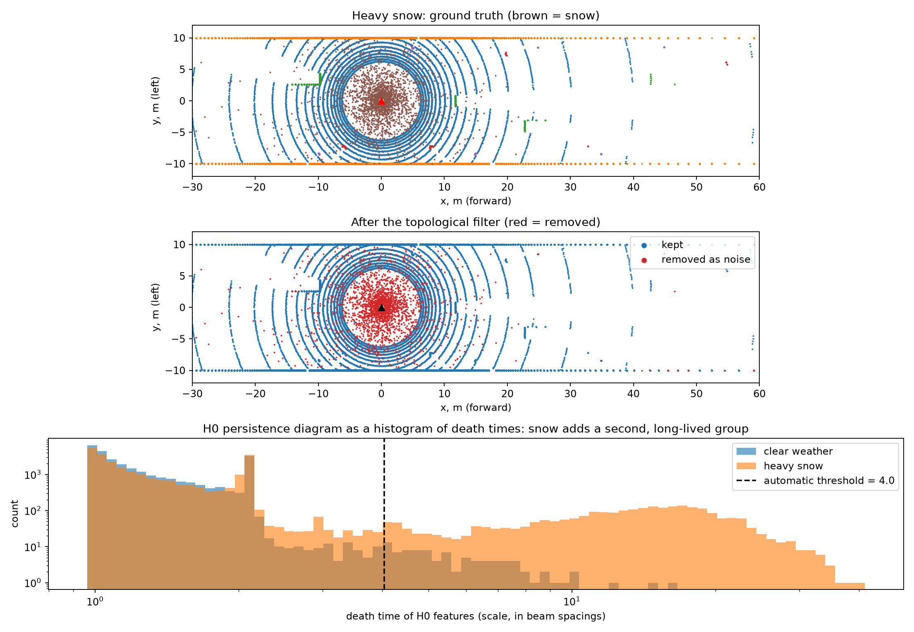
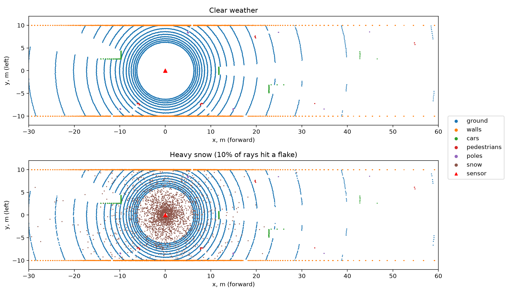
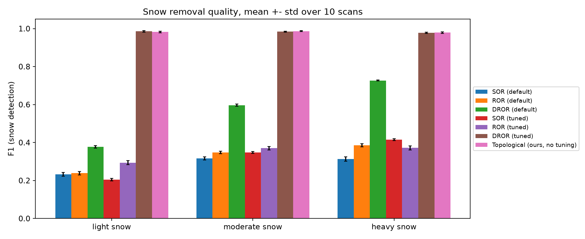
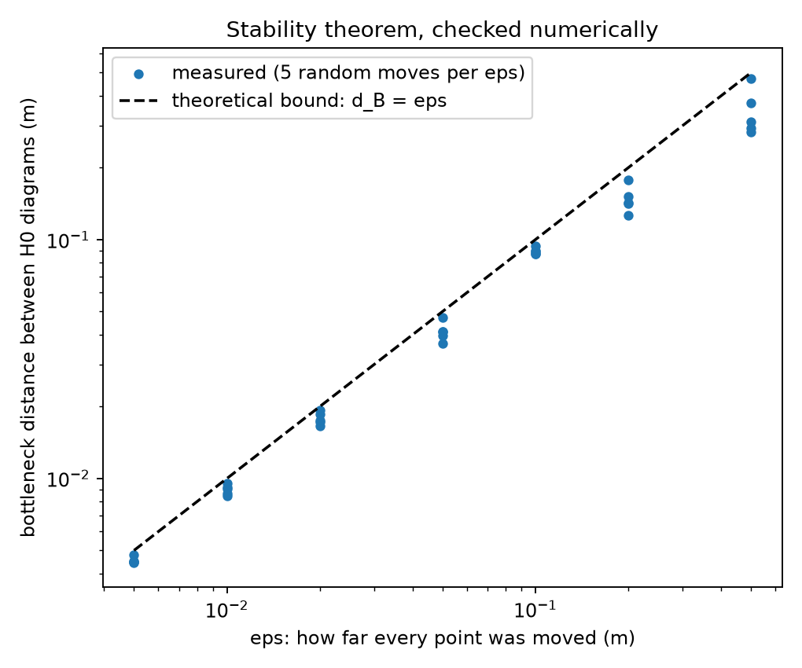
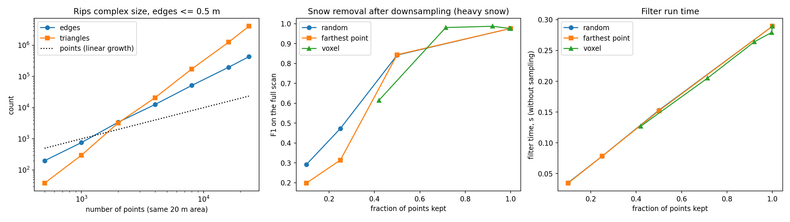

<h1 align="center">Topological filtering of snow in LiDAR point clouds</h1>

<p align="center">
  Can <b>persistent homology</b> tell falling snow apart from real objects in LiDAR scans, without hand-tuning a threshold?<br>
  A first experiment for my final-year project at the University of Birmingham.
</p>

<p align="center">
  
  
  
  
</p>

<p align="center">
  
</p>

## Key results

| | |
|---|---|
| **Snow removed** | **97–98%** of snow points, in light, moderate and heavy snow |
| **Real points kept** | **99.77–99.99%** (fewer than 0.25% removed by mistake) |
| **Tuning** | none: the threshold is read from the persistence diagram of each scan |
| **vs. best classic filter** | matches DROR tuned with ground-truth labels (F1 0.979–0.987 vs 0.978–0.986) |
| **Stability theorem** | bound held in 35/35 numerical checks |
| **Open problem** | naive downsampling destroys the topological signal |

**Contents:** [Why](#why) · [The idea](#the-idea) · [Setup](#setup) · [Results](#results) · [Conclusion](#conclusion) · [Limitations](#limitations) · [Next steps](#next-steps) · [Running it](#running-it)

## Why

Autonomous vehicles rely on LiDAR, and LiDAR struggles in snow, rain and fog: the laser reflects off snowflakes and the sensor reports thousands of false points in mid-air. Removing them is usually done with neighbour-counting filters whose parameters have to be tuned for each sensor and weather condition.

## The idea

Grow a scale from 0 upwards and watch points merge into connected components (H0 persistent homology):

- real surfaces are sampled densely, so their points merge into big components almost straight away;
- a snowflake return floats alone in the air and only joins something at a much larger scale.

Two details make this work on LiDAR:

1. **Distances are measured in beam spacings, not metres.** Far away the sensor samples sparsely (30 cm between shots is normal at 40 m but huge at 2 m), so every edge length is divided by `range × angular step`.
2. **The threshold comes from the persistence diagram.** Snow adds a second group of long-lived H0 features (bottom panel of the figure). Otsu's method finds the gap between the two groups automatically on every scan.

A point is marked as noise if it only becomes part of a component with at least 3 points after that threshold.

Implementation: k-nearest-neighbour graph (k = 10), Kruskal's algorithm with union-find to get the H0 diagram (death times = minimum spanning tree edges), see [`src/topology.py`](src/topology.py).

## Setup

All data is simulated so that every point has a ground-truth label ([`src/simulate.py`](src/simulate.py)):

- a 32-beam spinning LiDAR (-16° to +10°, 0.4° azimuth step, 1.8 m above the road, 2 cm range noise);
- a street with two building walls, 4 cars (boxes), 5 pedestrians and 6 poles (cylinders), one pedestrian far away at 55 m that only gets 4–6 points;
- a simple snow model: a fraction of beams (2% light, 5% moderate, 10% heavy) hits a snowflake at an exponentially distributed distance (mean 6 m), so snow points cluster around the car.

<p align="center">
  
</p>

Baselines ([`src/filters.py`](src/filters.py)): Statistical Outlier Removal (SOR), Radius Outlier Removal (ROR) and Dynamic Radius Outlier Removal (DROR, Charron et al. 2018, designed for snow). Each baseline is reported twice: with common default settings, and tuned with a grid search on **separate** scans using the true labels (their best case).

## Results

### Experiment 1: snow vs real objects

10 scans per snow level. Precision, recall and F1 of snow detection; "kept real" is the share of real points that survive.

| Method | Snow | Precision | Recall | F1 | Kept real |
|---|---|---|---|---|---|
| SOR (default) | heavy | 0.314 | 0.312 | 0.313 ± 0.012 | 0.934 |
| ROR (default) | heavy | 0.354 | 0.425 | 0.386 ± 0.008 | 0.925 |
| DROR (default) | heavy | 0.574 | 0.992 | 0.727 ± 0.003 | 0.929 |
| DROR (tuned with labels) | light | 0.985 | 0.986 | **0.986** ± 0.004 | 0.9997 |
| DROR (tuned with labels) | moderate | 0.987 | 0.982 | 0.984 ± 0.003 | 0.9994 |
| DROR (tuned with labels) | heavy | 0.985 | 0.971 | 0.978 ± 0.003 | 0.9985 |
| **Topological (no tuning)** | light | 0.995 | 0.970 | 0.982 ± 0.004 | **0.9999** |
| **Topological (no tuning)** | moderate | 0.996 | 0.978 | **0.987** ± 0.002 | **0.9998** |
| **Topological (no tuning)** | heavy | 0.977 | 0.981 | **0.979** ± 0.003 | 0.9977 |

Full table for all methods and snow levels: [`results/exp1_summary.csv`](results/exp1_summary.csv).

<p align="center"></p>

**What changes when conditions change?** All settings were kept fixed (DROR stays tuned for the baseline simulation) and one thing in the simulator was changed at a time. F1, mean over 5 scans:

| Condition | Snow | DROR (tuned) | Topological |
|---|---|---|---|
| baseline | heavy | 0.978 | 0.978 |
| snow further from the sensor (mean 15 m) | heavy | **0.975** | 0.966 |
| snow closer to the sensor (mean 2.5 m) | heavy | 0.969 | **0.985** |
| noisier sensor (5 cm) | heavy | 0.973 | **0.986** |

All snow levels: [`results/exp1_robustness.csv`](results/exp1_robustness.csv).

**Takeaways**

- Filters that ignore the distance to the sensor (SOR, ROR) cannot work here: far-away objects are as sparse as snow.
- The topological filter and a label-tuned DROR are about equally accurate. The difference is that DROR's radius had to be chosen using ground truth, while the topological filter picks its scale from the persistence diagram of each scan. In a sense DROR looks at one slice of the same filtration; persistence looks at all scales and chooses one.
- When conditions shift, neither method wins everywhere: the topological filter handles a noisier sensor and denser near-field snow better, DROR handles snow spread further out slightly better.

### Experiment 2: does the stability theorem hold?

The stability theorem says that if every point moves by at most ε, the persistence diagram moves by at most ε in bottleneck distance (balls of radius r). I moved 600 points from a scan by exactly ε in random directions and measured the bottleneck distance between the H0 diagrams ([`experiments/exp2_stability.py`](experiments/exp2_stability.py), own bottleneck implementation checked against brute force).

<p align="center"></p>

The bound held in all 35 runs and is almost tight for small ε (e.g. ε = 1 cm gives 0.84–0.96 cm). This is why small measurement noise cannot destroy the separation between surfaces and snow.

### Experiment 3: downsampling

The full Vietoris–Rips complex grows much faster than the number of points: in the same 20 m area, 2,000 points give about 3,400 edges and 3,200 triangles, while 23,000 points give 430,000 edges and 4 million triangles. Topology on full scans needs either a cheap filtration (like the graph used here) or downsampling.

<p align="center"></p>

Heavy snow, mean over 3 scans:

| Setting | Points kept | F1 | Kept real | Filter time, s |
|---|---|---|---|---|
| full scan | 100% | 0.976 | 0.997 | 0.67 |
| voxel grid 0.1 m | 92% | **0.987** | **0.9997** | 0.55 |
| voxel grid 0.2 m | 71% | 0.981 | 0.999 | 0.55 |
| voxel grid 0.4 m | 42% | 0.615 | 0.882 | 0.29 |
| random 50% | 50% | 0.842 | 0.971 | 0.33 |
| farthest point 50% | 50% | 0.844 | 0.968 | 0.32 |
| random 25% | 25% | 0.473 | 0.801 | 0.19 |

A voxel grid up to 0.2 m keeps (and even slightly improves) quality with ~30% fewer points, but naive random or farthest-point sampling breaks the filter quickly: once real surfaces are thinned out, they look as lonely as snow. **Designing a downsampling that preserves the topological signal is the main open question for the project.**

## Conclusion

On simulated scans, 0-dimensional persistent homology is enough to separate falling snow from real objects. Measuring distances in beam spacings makes the filter robust to the natural thinning of LiDAR points with distance, so a pedestrian 55 m away is not confused with a snowflake 2 m away. The persistence diagram itself shows two clear groups, surfaces and snow, and that gap gives a threshold for every scan without any labelled data.

The result is not "better than everything": a carefully tuned DROR is just as accurate. What persistence adds is a principled way to choose the scale automatically, plus a stability guarantee that I checked numerically. The weak points are clear too. Very small or fragmented objects can be removed, the Python implementation is about 10 times slower than DROR, and naive downsampling destroys the topological signal. These three issues, together with testing on real snowy scans, define the next stage of the project.

## Limitations

- **Simulated data only.** The snow model is simple (no physical backscatter model, no clustering of flakes, no fog), and the scene is idealised. Results on real scans may differ.
- **Very small objects:** anything that returns fewer than 3 points, or is split into fragments of fewer than 3 points, is removed. This happened once to the far pedestrian (in one heavy-snow scan out of 10 it was split into two pairs of points and both pairs were removed); the tuned DROR kept it in all scans.
- **Grazing surfaces:** far parts of walls seen at a sharp angle are sampled sparsely, and most of the remaining false removals are there.
- **Speed:** the union-find loop is plain Python, about 0.6 s per scan versus about 0.06 s for DROR. Fine for experiments, too slow for a car.
- Only H0 is used. Higher-dimensional features (loops, voids) are not used yet.

## Next steps

1. Run the same filter on real snowy scans with point-wise labels (for example WADS, the Winter Adverse Driving dataSet).
2. Topology-aware downsampling: keep the points that matter for the persistence diagram instead of thinning uniformly.
3. Use the full persistence diagram (and H1) as features for a learned filter.
4. Rain and fog, which behave differently from snow.

## Running it

```bash
pip install -r requirements.txt
python src/simulate.py
python src/topology.py
python experiments/exp1_snow_vs_objects.py
python experiments/exp2_stability.py
python experiments/exp3_downsampling.py
```

- `simulate.py` draws a clear and a snowy scan (`figures/scan_clear_vs_snow.png`).
- `topology.py` runs the filter on one heavy-snow scan.
- Experiment 1 takes about 1–2 min, experiment 2 about 10 s, experiment 3 about 1 min.
- `gudhi` is optional (only used for a cross-check in experiment 2).

Everything is seeded, so the numbers above are reproducible.

## Structure

```
requirements.txt
src/
  simulate.py     LiDAR + street scene + snow, with ground-truth labels
  topology.py     H0 persistence and the topological filter
  filters.py      SOR, ROR, DROR baselines
  metrics.py      precision, recall, F1
experiments/      one script per experiment, write to results/ and figures/
```

## References

- H. Edelsbrunner, J. Harer. *Computational Topology: An Introduction.* AMS, 2010.
- D. Cohen-Steiner, H. Edelsbrunner, J. Harer. Stability of persistence diagrams. *Discrete & Computational Geometry*, 2007.
- N. Charron, S. Phillips, S. L. Waslander. De-noising of lidar point clouds corrupted by snowfall. *CRV*, 2018.
- N. Otsu. A threshold selection method from gray-level histograms. *IEEE Trans. SMC*, 1979.

Gleb Efremenko, University of Birmingham
